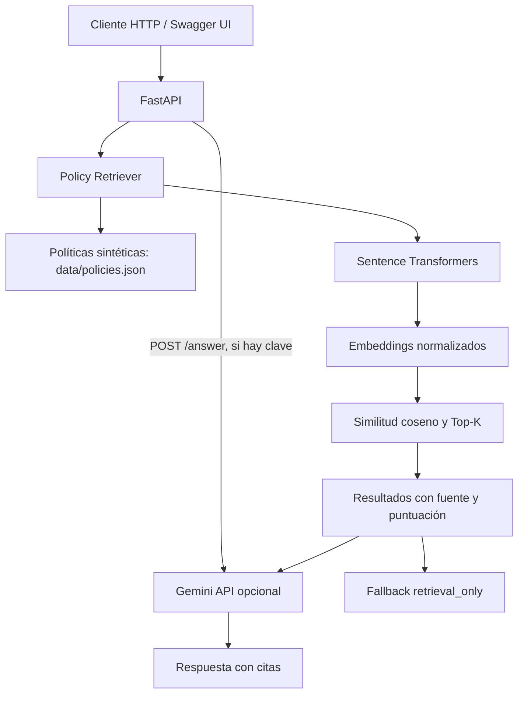

# Support Knowledge RAG API

**API REST para recuperación de políticas de soporte mediante embeddings y búsqueda vectorial, con generación opcional de respuestas fundamentadas en evidencia.**

Este es un proyecto personal de portafolio para demostrar fundamentos de Retrieval-Augmented Generation (RAG): recuperar información relevante, devolver fuentes identificables y evitar presentar una respuesta generada cuando no está disponible el modelo de lenguaje.

> **Alcance:** demostración técnica con políticas y datos sintéticos. No está afiliada a Rappi, no utiliza políticas de empresas reales y no ejecuta acciones sobre pedidos, pagos o compensaciones. No introduzcas datos personales ni información confidencial.

## Objetivos del proyecto

- Exponer una API documentada con FastAPI y OpenAPI/Swagger.
- Convertir las políticas en embeddings con Sentence Transformers.
- Recuperar documentos mediante similitud coseno.
- Devolver fragmentos, puntuaciones y referencias a las fuentes.
- Permitir generación opcional con Gemini utilizando la evidencia recuperada como contexto.
- Degradar de forma controlada a `retrieval_only` cuando Gemini no esté configurado o falle.
- Probar el contrato y el orden de recuperación sin depender de una API externa.

## Funcionalidades

| Funcionalidad | Implementación actual |
|---|---|
| Consulta de salud | `GET /health` |
| Listado de políticas | `GET /policies` |
| Recuperación semántica | `POST /search` |
| Respuesta con evidencia recuperada | `POST /answer` |
| Fuentes y citas | IDs, títulos, fuente y puntuación de los documentos recuperados |
| Fallback sin LLM | `/answer` devuelve `generation_mode: retrieval_only` si no puede generar una respuesta |
| Pruebas unitarias | `pytest`, usando un encoder determinista de prueba |

## Arquitectura



La API carga el conjunto de políticas desde `data/policies.json`. En la primera recuperación, el codificador carga el modelo de embeddings y calcula los vectores de los documentos. La pregunta también se convierte en embedding y se compara con los vectores normalizados mediante similitud coseno. El índice se mantiene en memoria durante la vida del proceso.

Para más detalles, consulta [`docs/architecture.md`](docs/architecture.md) y [`docs/evaluation.md`](docs/evaluation.md).

## Tecnologías

- Python
- FastAPI y Pydantic
- Uvicorn
- Sentence Transformers (`sentence-transformers/all-MiniLM-L6-v2`)
- NumPy
- Google Gen AI SDK (generación opcional)
- pytest

## Estructura del repositorio

```text
support-knowledge-rag-api/
├── app/
│   ├── main.py             # Endpoints FastAPI y generación opcional
│   └── retriever.py        # Embeddings, similitud y ranking Top-K
├── data/
│   └── policies.json       # Políticas sintéticas con ID y fuente
├── docs/
│   ├── architecture.md    # Flujo, decisiones y limitaciones
│   └── evaluation.md      # Consultas y métricas propuestas
├── tests/
│   └── test_retriever.py  # Pruebas unitarias de recuperación
├── .env.example
├── .gitignore
├── requirements.txt
└── README.md
```

## Requisitos

- Python 3.11 o superior. Python 3.13 puede funcionar según la compatibilidad de las dependencias instaladas.
- Conexión a internet la primera vez que se descarga el modelo de embeddings.
- Una clave de Gemini solo si quieres habilitar la generación de respuestas. La búsqueda `/search` no necesita clave API.

## Instalación en Windows (PowerShell)

Clona el repositorio o descarga el ZIP y abre PowerShell en la carpeta `support-knowledge-rag-api`.

Crea un entorno virtual:

```powershell
python -m venv .venv
```

Si `python` no se reconoce y Python está instalado en la ruta de perfil de Windows, puedes invocarlo directamente. Ajusta `Python313` si tu versión o ubicación es diferente:

```powershell
& "$env:LocalAppData\Programs\Python\Python313\python.exe" -m venv .venv
```

Instala las dependencias:

```powershell
.\.venv\Scripts\python.exe -m pip install --upgrade pip
.\.venv\Scripts\python.exe -m pip install -r requirements.txt
```

Crea el archivo local de variables de entorno:

```powershell
Copy-Item .env.example .env
```

Para habilitar generación con Gemini, edita `.env` localmente:

```dotenv
GEMINI_API_KEY=TU_CLAVE_API
GEMINI_MODEL=gemini-3.8-flash
EMBEDDING_MODEL=sentence-transformers/all-MiniLM-L6-v2
```

La clave es opcional para recuperación. **Nunca publiques `.env`, claves API ni credenciales en GitHub.** Si compartiste una clave accidentalmente, revócala y crea una nueva.

## Ejecutar la API

Inicia el servidor enlazado a tu computador:

```powershell
.\.venv\Scripts\python.exe -m uvicorn app.main:app --reload --host 127.0.0.1 --port 8000
```

Abre la documentación interactiva:

- Swagger UI: [http://127.0.0.1:8000/docs](http://127.0.0.1:8000/docs)
- OpenAPI JSON: [http://127.0.0.1:8000/openapi.json](http://127.0.0.1:8000/openapi.json)
- Salud: [http://127.0.0.1:8000/health](http://127.0.0.1:8000/health)

La primera consulta puede tardar mientras se descarga y carga el modelo de embeddings.

## Probar los endpoints

### 1. Salud del servicio

```powershell
Invoke-RestMethod http://127.0.0.1:8000/health
```

### 2. Listar las políticas sintéticas

```powershell
Invoke-RestMethod http://127.0.0.1:8000/policies
```

### 3. Recuperar las políticas más relevantes

```powershell
$body = @{
  query = "Mi pedido llegó tarde, ¿qué política aplica?"
  top_k = 3
} | ConvertTo-Json

Invoke-RestMethod -Method Post `
  -Uri http://127.0.0.1:8000/search `
  -ContentType "application/json" `
  -Body $body
```

La respuesta incluye la consulta y una lista ordenada de resultados con `id`, `title`, `category`, `source`, `text` y `score`. La puntuación representa similitud vectorial; **no es una probabilidad de que el documento sea correcto**.

### 4. Recuperar evidencia y generar una respuesta opcional

```powershell
$body = @{
  query = "¿Qué debo hacer si un pedido llega tarde?"
  top_k = 3
} | ConvertTo-Json

Invoke-RestMethod -Method Post `
  -Uri http://127.0.0.1:8000/answer `
  -ContentType "application/json" `
  -Body $body
```

Si `GEMINI_API_KEY` está configurada y la API responde, el resultado utiliza `generation_mode: retrieval_augmented_generation` e incluye citas y evidencia. Si no hay clave o ocurre un error durante la generación, la API devuelve evidencia en modo `retrieval_only` y un aviso en vez de fingir que se generó una respuesta.

## Pruebas automatizadas

En otra terminal, desde la raíz del proyecto, ejecuta:

```powershell
.\.venv\Scripts\python.exe -m pytest -q
```

Las pruebas utilizan un encoder determinista de prueba, por lo que no requieren descargar Sentence Transformers ni consumir cuota de Gemini. Validan comportamiento y ranking del retriever; no equivalen a una evaluación de calidad semántica del modelo real.

## Consultas de evaluación propuestas

El conjunto de datos incluye políticas sintéticas para temas como:

- Demoras en la entrega.
- Cancelación de pedidos.
- Productos faltantes.
- Productos o empaques dañados.
- Transferencia a una persona.
- Protección de claves API y datos sensibles.

Una siguiente iteración debería medir `Recall@k`, `MRR`, latencia de recuperación, cobertura de citas y frecuencia de fallback con un conjunto de preguntas etiquetadas. No se publican métricas de calidad porque aún no se ha ejecutado esa evaluación sobre un dataset representativo.

## Relación con SupportPilot

Este servicio está pensado como una pieza separada que podría ser consumida por [SupportPilot AI Agent](https://github.com/julianandreszapata/supportpilot-ai-agent). SupportPilot representa la capa conversacional y de herramientas; esta API se concentra en recuperar conocimiento y devolver evidencia. **La integración entre ambos proyectos todavía no está implementada.**

## Limitaciones conocidas

- Dataset pequeño, estático y sintético; no representa políticas de ninguna empresa real.
- Índice vectorial mantenido en memoria, sin pgvector, base vectorial persistente ni actualización dinámica.
- Sin autenticación, autorización, multi-tenancy, control de acceso por país ni versionado de vigencia.
- Sin evaluación formal de calidad, latencia o coste sobre una carga representativa.
- Gemini es opcional; la generación está sujeta a conectividad, disponibilidad del modelo y cuota API.
- No tiene integración con WhatsApp, Amazon Connect, pagos ni sistemas de casos reales.

## Roadmap

1. Persistir los vectores con PostgreSQL + pgvector o Supabase.
2. Añadir metadatos de vigencia, país, versión y categoría a las políticas.
3. Implementar autenticación, límites de solicitudes y logging estructurado.
4. Construir un conjunto de evaluación etiquetado y reportar `Recall@k` / `MRR` reproducibles.
5. Añadir pruebas de integración y pipeline CI.
6. Integrar con SupportPilot mediante una API interna claramente versionada.

## Autor

**Julian Zapata** — Software Engineer enfocado en backend, APIs, integraciones y prototipos de IA.

- GitHub: [julianandreszapata](https://github.com/julianandreszapata)
- LinkedIn: [linkedin.com/in/julianandreszapata](https://www.linkedin.com/in/julianandreszapata/)

---

*Proyecto educativo de portafolio. Describe exactamente el alcance implementado y no debe interpretarse como un sistema de soporte productivo.*
